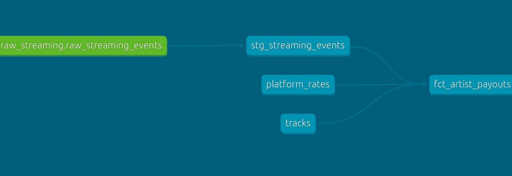

# Streaming Analytics

A local streaming analytics demo built with Redpanda (Kafka-compatible), PostgreSQL, a Python event producer/consumer, and a dbt project.

## Components

- **Redpanda** receives events on the `stream-events` Kafka topic.
- **`producer.py`** emits JSON events containing `track_id`, `user_id`, `timestamp`, and `platform`. Track IDs are selected from `royalty_transformation/seeds/tracks.csv`.
- **`consumer.py`** reads the topic and inserts events into PostgreSQL's `raw_streaming_events` table, including Kafka partition and offset metadata. Duplicate partition/offset pairs are ignored.
- **PostgreSQL** stores streaming events in the `streaming_analytics` database.
- **`royalty_transformation/`** is the dbt project; its seed CSVs are in `royalty_transformation/seeds/`.

### dbt DAG



## Requirements

- Docker Engine and Docker Compose
- Python 3.12+ to run the producer locally
- (Optional) dbt with the PostgreSQL adapter to run transformations

## Start the services and create the table

From the project root, start PostgreSQL and Redpanda first:

```bash
docker compose up -d postgres redpanda
docker compose ps
```

Wait until PostgreSQL is healthy and Redpanda is healthy. Then create the event table from the project schema:

```bash
docker compose exec -T postgres psql -U analytics -d streaming_analytics < setup.sql
```

Start the consumer after the table exists:

```bash
docker compose up -d consumer
```

The Compose consumer installs dependencies from `requirements.txt` when it starts. Follow its output with:

```bash
docker compose logs -f consumer
```

## Create the Kafka topic and produce events

Create the topic in Redpanda (if it does not already exist):

```bash
docker compose exec redpanda rpk topic create stream-events
```

Create a local virtual environment and install the Python dependencies:

```bash
python3 -m venv .venv
.venv/bin/pip install -r requirements.txt
```

Run the producer from the project root in a separate terminal:

```bash
.venv/bin/python producer.py
```

The producer defaults to `localhost:19092`, emits one event every two seconds, and can be stopped with Ctrl+C. Override its defaults with `KAFKA_BOOTSTRAP_SERVERS`, `KAFKA_TOPIC`, and `EVENT_INTERVAL_SECONDS` if needed.

## Query PostgreSQL

Connect interactively:

```bash
docker compose exec postgres psql -U analytics -d streaming_analytics
```

Then query recent events:

```sql
SELECT * FROM raw_streaming_events ORDER BY event_id DESC LIMIT 20;
```

Or run a query directly:

```bash
docker compose exec postgres psql -U analytics -d streaming_analytics -c "SELECT * FROM raw_streaming_events ORDER BY event_id DESC LIMIT 20;"
```

From the host, PostgreSQL is available at `localhost:5433`. Within the Compose network, other containers use `postgres:5432`.

## dbt project

The dbt project is in `royalty_transformation/`. Configure a dbt profile named `royalty_transformation` in `~/.dbt/profiles.yml`. When running dbt from the host, use the PostgreSQL host port and credentials from Compose, for example:

```yaml
royalty_transformation:
  target: dev
  outputs:
    dev:
      type: postgres
      host: localhost
      port: 5433
      user: analytics
      pass: analytics_dev_password
      dbname: streaming_analytics
      schema: dbt_transformations
      threads: 4
```

From the dbt project directory, load seeds and check the connection with:

```bash
cd royalty_transformation
dbt debug
dbt seed
```

## Logs and troubleshooting

```bash
docker compose ps
docker compose logs -f postgres
docker compose logs -f redpanda
docker compose logs -f consumer
```

If dbt reports a connection error, confirm that its host profile uses `localhost:5433` (not `localhost:5432`) when dbt runs on the host. For other common issues, see [troubleshooting.md].

## Stop services

Stop the containers while retaining database and Redpanda data volumes:

```bash
docker compose down
```

To also delete the persisted volumes and all data, use `docker compose down -v`. This is destructive.
